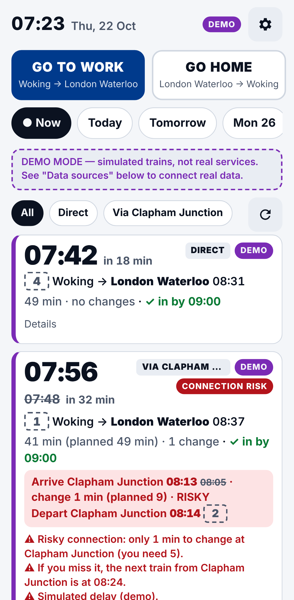
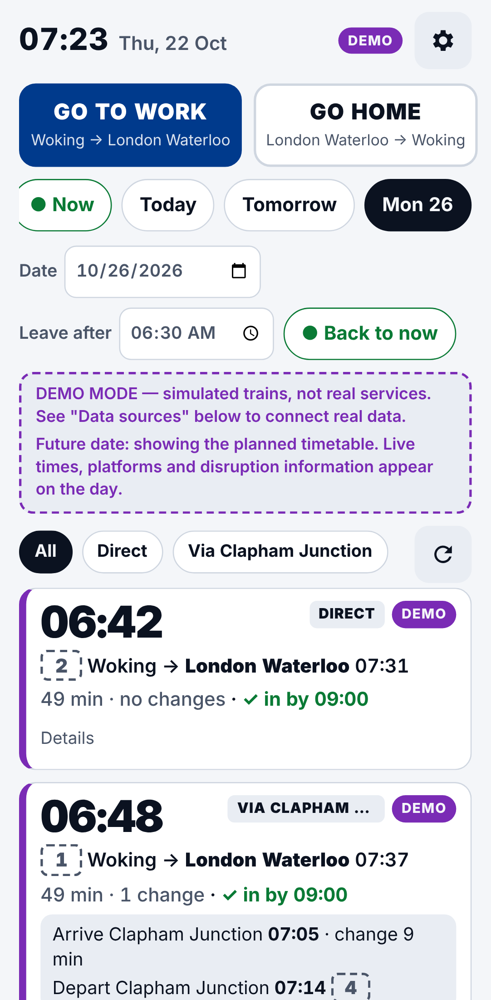

# Next Train — personal National Rail commute dashboard

A mobile-first PWA that answers one question in under 5 seconds: **what's my best next train to work, or home?**

Open it, tap **GO TO WORK** or **GO HOME**, and you see your next five journeys. Direct trains (A → B) and connections via your change station (A → C → B) appear in one ranked list. Each card shows:

- departure and arrival times
- duration and number of changes
- the connection at C and the wait there
- platform
- live delays and cancellations
- whether the data is **Live**, **Timetable**, **Cached** or **Demo**

 

*Screenshots are from DEMO mode (simulated trains, `DEMO_SCENARIO=disrupted`).*

---

## Quick start

```bash
cd apps/rail-dashboard
npm install
npm run build
npm start                 # http://localhost:8787
```

Node **22.18+** is required. The server runs TypeScript directly through Node's built-in type stripping, so there is no compile step for the server.

With no credentials the app runs in **DEMO mode**. Every screen and every card says the trains are simulated. On first open, pick your home, work and (optional) change station using the station search. They're saved on the device.

To use real trains, add the credentials in `.env` (copy `.env.example`). See [Data sources](#data-sources) below.

| Command | What it does |
|---|---|
| `npm run build` | Bundles the client into `dist/public` (app.js ≈ 25 KB, minified). |
| `npm start` | Starts the server (API + static PWA). |
| `npm run dev` | Builds the client, then runs the server with `--watch`. |
| `npm test` | 93 unit + integration tests (`node:test`, no extra deps). |
| `npm run typecheck` | `tsc --noEmit` for app, tests and service worker. |
| `npm run check` | Typecheck + tests + build. |
| `npm run timetable:import -- …` | Imports the Network Rail timetable (see below). |
| `npm run measure` | Measures time-to-useful-results in headless Chromium (see [Performance](#performance)). |

---

## Data sources

| Need | Source | Access | Status in this app |
|---|---|---|---|
| Live departures, delays, cancellations, platforms (next ~2 h) | **National Rail Darwin – Live Departure Board (LDBWS)**, served via the [Rail Data Marketplace](https://raildata.org.uk) | Free account. Subscribe to "Live Departure Board", then copy the consumer key into `DARWIN_API_KEY` | Implemented (`src/server/providers/darwin.ts`) |
| Scheduled services for **any date**, including engineering-works changes | **Network Rail SCHEDULE feed** (CIF JSON full extract) from [NROD](https://publicdatafeeds.networkrail.co.uk), also listed on RDM | Free registration. Set `NROD_USERNAME`/`NROD_PASSWORD`, or download the file yourself | Implemented (`src/server/timetable/*`) |
| Complete journey planning with official connection rules | **NRE Online Journey Planner (OJP) feed** | Licensed via National Rail / RDG. Not self-service for personal use | Not used. The provider interface lets you add it later |
| Station names/codes for search | [`uk-railway-stations`](https://github.com/davwheat/uk-railway-stations) (ODbL) | Bundled | Implemented |

**Why not just a departure board?** A departure board isn't a journey planner. This app uses LDBWS `GetDepBoardWithDetails` filtered *to* the destination, which gives each train's arrival time from its calling points. It fetches three boards per direction (A→B, A→C, C→B) and builds and validates the connections itself (see [Connection validation](#connection-validation)).

**Credentials stay on the server.** The browser only calls `/api/*`. `DARWIN_API_KEY` is sent upstream in the `x-apikey` header, never in a URL, and it never appears in an API response (this is tested). `.env` is git-ignored.

### Which source answers a search

| Search | Source used |
|---|---|
| Today, within the next ~2 hours | Darwin live data |
| Today beyond 2 hours, or any other date | Imported timetable, labelled **Timetable** |
| Window straddling the 2-hour boundary | Live first, then timetable (badge **Live + timetable**) |
| Darwin down or rate-limited | The last live board, flagged **Stale** (up to 15 min). Otherwise the timetable, with a notice. Otherwise the error is shown and the phone falls back to its **Cached** results, with their age |
| Only Darwin configured, other date | A clear message: live data only covers ~2 hours, so import the timetable |
| Nothing configured | **Demo** mode |

### Live data setup (Darwin via Rail Data Marketplace)

1. Create an account at <https://raildata.org.uk> and subscribe to **Live Departure Board** (LDBWS).
2. Open the product's *Specification* tab and copy the **consumer key** into `.env` as `DARWIN_API_KEY`.
3. If the endpoint shown there differs from the default `https://api1.raildata.org.uk/1010-live-departure-board-dep/LDBWS/api/20220120`, set `DARWIN_BASE_URL`.
4. Restart. The header badge should read **Live**.

> **Not yet verified against the live service.** The rail data hosts weren't reachable from the environment this was built in. The adapter was written to the published LDBWS schema and tested against hand-written fixtures in that shape (`test/fixtures/darwin-*.json`). It accepts camelCase and PascalCase field names. If the first live call shows nothing, compare one raw response with `boardToLegs()` in `src/server/providers/darwin.ts`.

### Scheduled timetable setup (Network Rail SCHEDULE)

```bash
# Option A – download with your NROD login (set NROD_USERNAME / NROD_PASSWORD in .env)
npm run timetable:import -- --download --stations WOK,WAT,CLJ

# Option B – a CIF JSON full extract you downloaded yourself (.gz is fine)
npm run timetable:import -- --file ~/Downloads/toc-full.json.gz --stations WOK,WAT,CLJ
```

This writes `data/timetable.json`, which holds only the passenger services calling at two or more of your stations (usually a few hundred KB). Restart the server afterwards.

- **Include every station you use**, plus any you might switch to. If you change A, B or C in the app, re-run the import.
- Network Rail publishes short-term changes (engineering works, special timetables) as STP overlays and cancellations. These are applied per date, and the `X` (doesn't run on bank holidays) flag is honoured. **Re-import weekly**, for example with a cron job:
  ```
  15 4 * * 1 cd /path/to/apps/rail-dashboard && npm run timetable:import -- --download && systemctl restart rail-dashboard
  ```
- England & Wales bank holidays for 2025–2027 are built in (`src/shared/calendar.ts`). Add more with `BANK_HOLIDAYS=`.

---

## Using the dashboard

- **GO TO WORK / GO HOME.** The app picks the likely direction from the London clock: before the midpoint between your morning and evening windows it chooses work, after it home. If you tapped a direction in the last 20 minutes, it keeps that one. You can fix it in Settings. Home-screen shortcuts `?go=work` and `?go=home` are included.
- **Date & time.**
  - **● Now** is the live commute.
  - **Today**, **Tomorrow** and the next five weekdays are one tap each. **📅 Pick date** opens any date.
  - **Leave after** sets the departure time and defaults to the start of that commute window. The window length (1–4 h) is in Settings.
  - A planned selection is remembered for 30 minutes, then the app opens on the live commute again. **● Back to now** returns at any time.
- **Cards.**
  - The departure time is the largest text. A delayed train shows its expected time with the booked time struck through.
  - A solid platform box means Darwin reported the platform. A dashed box means the timetable's planned platform.
  - "✓ in by 09:00" uses your *arrive at work by* time.
  - **Details** expands to operator, train destination and source for each leg.
  - Cancelled services are listed separately, never counted as options.
- **All / Direct / Via C** filters the list. **Show more options** extends to 10, then 15 journeys with a longer window.
- **Refresh.** Manual refresh, plus auto-refresh (30 s – 5 min, default 1 min). Auto-refresh only runs while the page is visible and only for today's searches. It backs off when rate-limited.
- **Footer.** Shows the data source, the last successful update time and *Data sources & limitations*.

### Settings

All settings stay on the device (localStorage):

- stations A, B, C (search by name or CRS code)
- morning and evening windows
- earliest and latest acceptable departure
- arrive-at-work-by time
- default direction
- minimum change time
- extra walking time
- maximum changes (0 or 1)
- prefer direct trains
- refresh frequency
- search window

---

## Connection validation

`src/shared/planner.ts` is pure and unit-tested:

1. **Planned connection.** The earliest onward train at C whose *timetabled* departure is at least *min change time + walking time* after the first train's timetabled arrival. Waits over 90 minutes are rejected. A train is never "connected" to itself.
2. **Live re-check.**
   - If delays shrink the interchange below your minimum but it's still possible, the card is flagged **Connection risk** and names the next onward train.
   - If the connection becomes impossible, the journey is **re-planned** onto the next feasible train, with a warning.
   - If the first train shows "Delayed" with no estimate, the connection is marked **uncertain**.
   - A cancelled onward train is skipped, and the card says so.
3. **De-duplication and ranking.**
   - Identical leg combinations are merged.
   - A journey that leaves no later and arrives no earlier, with no fewer changes, is dropped. A risky journey never hides a safe one.
   - With *prefer direct* on, a connection is hidden when a direct train leaves no earlier and arrives at most 5 minutes later.
   - Results are ranked by departure time (then arrival, then changes).
4. **Fewer than five.** When fewer than five journeys are found, the app explains why: the window, cancellations, max changes = 0, the live 2-hour limit, late-night service, or Christmas.

**Limitations.** These feeds don't provide official station minimum connection times, guaranteed-connection rules or interchange walking times. The app applies your own conservative minimum instead. Add extra time at large stations.

---

## Performance

Measured with `npm run measure`. This uses headless Chromium with Pixel 7 emulation, a **slow-4G** network (150 ms RTT, 1.6 Mbps) and a **4× CPU slowdown**. The server runs in demo mode with its response cache disabled, 5 runs each, median shown:

| Upstream latency (simulated) | Cold start → first results | Warm start → cached results shown | Warm start → fresh results | Tap GO HOME → fresh results |
|---|---|---|---|---|
| 0 ms | 0.68 s | 0.25 s | 0.44 s | 0.18 s |
| 1500 ms | 2.06 s | 0.27 s | 1.82 s | 1.55 s |
| 3000 ms | 3.57 s | 0.27 s | 3.33 s | 3.05 s |

The under-5-second target is met in these configurations. The app always shows the last cached results for your route at about 0.3 s, labelled **Cached** with their age, while it fetches fresh ones.

**Real Darwin latency has not been measured**, because no credentials were available. A live search makes three board requests in parallel, plus extra pages when a board is full. Each request times out after 4 s, and boards are cached server-side for 30 s. To measure your real setup, run `npm run measure -- --base-url http://localhost:8787` against your own server.

Optimisations in place:

- no framework, and an app shell precached by the service worker
- gzip, with minimal JSON
- skeleton cards instead of a blank screen
- server-side 30 s board cache and 15 s response cache
- device cache of the last 12 routes
- the station list (≈ 56 KB) loads only when Settings opens

---

## Deployment

The app is a single Node process with no database.

```bash
# Any Node 22.18+ host / VPS
npm ci && npm run build && npm start

# Docker
docker build -t next-train .
docker run -p 8787:8787 --env-file .env -v $PWD/data:/app/data next-train
```

- Serve it over **HTTPS** (needed for PWA install and the service worker), e.g. behind Caddy, nginx, Fly.io, Render or Railway.
- If the URL is public, set `BASIC_AUTH_USER` / `BASIC_AUTH_PASSWORD`. This stops strangers using up your Darwin quota. `/api/health` stays open for health checks.
- There is a built-in rate limit of 120 API requests per minute per IP.
- **Install on your phone:** open the site, then use *Add to Home Screen* (iOS Safari) or *Install app* (Android Chrome).

---

## Architecture

```
src/
  shared/      pure logic, used by server + client (all unit-tested)
    time.ts        Europe/London conversions, DST, midnight roll-over
    planner.ts     journey building, transfer validation, ranking, shortfall text
    commute.ts     settings, default direction, date chips, query building
    display.ts     freshness labels, cache pruning, failure fallback
    query.ts       URL encode/decode + validation
    calendar.ts    bank holidays
  server/
    main.ts / app.ts   node:http server, JSON API, static files, auth, rate limit
    journeys.ts        picks live/timetable/demo per request, runs the planner
    providers/         provider abstraction + Darwin + demo
    timetable/         CIF import, compact store, STP rules
  client/          vanilla TS PWA (main.ts, render.ts, storage.ts, sw.ts)
test/
  unit/            planner, time/DST, date selection, display/caching, query
  integration/     Darwin adapter (fixtures, paging, 401/429, stale), CIF import + timetable,
                   HTTP API (demo, missing credentials, errors, auth, rate limit)
```

**Swapping the data provider.** Implement `LegProvider` (or `LiveLegProvider` / `ScheduledLegProvider`) from `src/server/providers/types.ts`, which returns `Leg[]` for a station pair and time window. Then wire it up in `src/server/config.ts`. The planner and UI don't change.

### API

- `GET /api/journeys?from=WOK&to=WAT&via=CLJ&date=2026-10-22&time=07:40&window=120&mt=5&walk=0&changes=1&direct=1&count=5[&earliest=HH:MM&latest=HH:MM]` returns a `JourneyResponse` (`src/shared/types.ts`).
- `GET /api/status` lists the configured sources and what's missing.
- `GET /api/stations?q=clap` searches stations.
- `GET /api/health` is the health check.

---

## What works, what needs credentials, what's incomplete

| Feature | State |
|---|---|
| Dashboard, GO TO WORK / GO HOME, five ranked journeys, direct + via-C, cards, filters, more options | ✅ Works (demo without credentials) |
| Connection validation, risk warnings, re-planning, de-dup, shortfall explanations | ✅ Works, unit-tested |
| Any-date planner (today / tomorrow / weekdays / any date, time window), remembered selection | ✅ Works |
| PWA install, offline shell, cached results with age, manual + auto refresh, last-update time | ✅ Works |
| Settings incl. station search and all listed preferences | ✅ Works |
| Live delays, cancellations, platforms, disruption messages | 🔑 Needs `DARWIN_API_KEY`. Built and fixture-tested, not yet run against the live service |
| Real timetable for future dates, weekends, bank holidays, engineering works | 🔑 Needs the Network Rail SCHEDULE import. Built and fixture-tested, not yet run on a real extract |
| Official minimum connection times / guaranteed connections / full national journey planning | ❌ Not available from these feeds (the OJP feed is licensed). Your own minimum is applied instead |
| Replacement buses in the timetable | ❌ Not imported. Bus-only schedules are skipped |
| More than one change | ❌ By design: only A→B and A→C→B |
